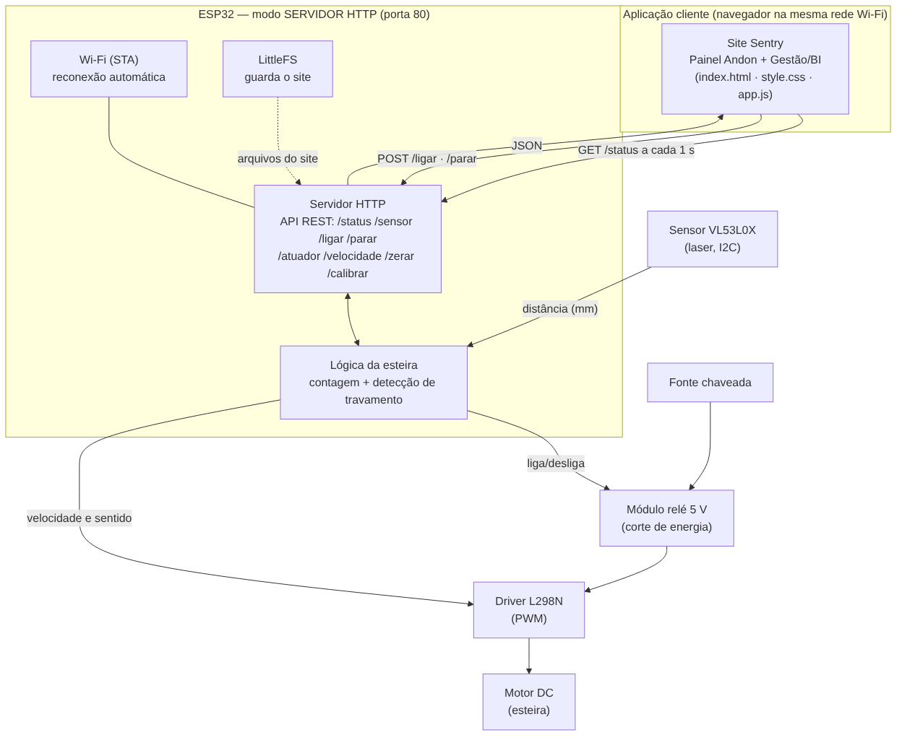
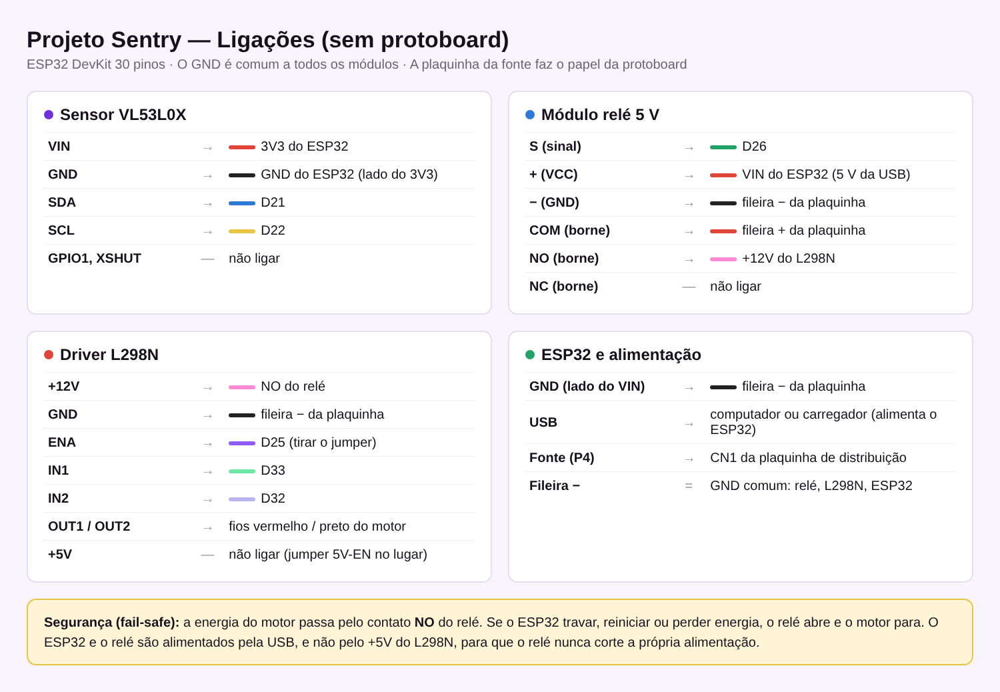

# Projeto Sentry

**Contagem autônoma de peças e parada de segurança em esteira com ESP32**

Disciplina: Conectividade em Sistemas Ciberfísicos · Engenharia de Software · PUCPR · 2026/2
Professor: Fábio Bettio

---

## O problema

Em linhas de montagem de peças pequenas, a contagem costuma ser manual e sujeita a erro, e o travamento de uma peça na esteira muitas vezes só é percebido tarde, com o motor forçando e danificando a peça ou o equipamento.

## A solução

O Sentry usa **um único sensor laser de distância (VL53L0X)** sobre a esteira para:

1. **contar** cada peça que passa por baixo dele;
2. **detectar travamento**: se a peça fica parada sob o sensor por mais de 3 segundos, o ESP32 **corta a energia do motor pelo relé** na hora.

O ESP32 funciona como **servidor HTTP** na rede Wi-Fi local. Ele expõe uma API REST para consultar o sensor e comandar o motor, e hospeda no **LittleFS** o site do painel, com uma tela **Andon** para o operador e uma tela de **Gestão (BI)** para o gestor.

## Integrantes

| Nome completo | RA | GitHub | Papel principal |
|---|---|---|---|
| Amanda Beatriz | [RA] | [@abtriz](https://github.com/abtriz) | Hardware & Firmware: lógica da esteira (sensor, contagem, travamento, motor, memória da contagem) e README |
| Enzo Bridarolli | [RA] | [@EnzoBrida0] | Protocolos & Conectividade: Wi-Fi, servidor HTTP, API, LittleFS e testes da API |
| Fernando Consul | [RA] | [@ConsulFernando] | Hardware: montagem física, pinagem, alimentação e segurança elétrica |
| Flávia Karpem | [RA] | [@FlaviaKp] | Interface & Organização do repositório: site, painel Andon, painel de BI, estrutura e .gitignore |
| Inacio Mota  | [RA] | [@inslmota] | Documentação técnica: arquitetura, API, plano de testes e manual de operação |

## Arquitetura da solução



- **Cliente:** navegador na mesma rede Wi-Fi. O site consulta `GET /status` a cada 1 s e envia comandos por `POST`.
- **Servidor:** ESP32 em modo estação (STA), servidor HTTP na **porta 80** (biblioteca `WebServer`). Transporte **TCP**, escolhido porque cada comando de parar ou ligar precisa chegar com confirmação de entrega.
- **Sensor:** VL53L0X via I2C (D21/D22), leitura contínua a cada 30 ms.
- **Atuadores:** relé 5 V (corte físico da energia) e motor DC via driver L298N (velocidade por PWM).

Esboço inicial do projeto: [docs/esboço_tecnico.png](docs/esboço_tecnico.png)

## Hardware utilizado

| Componente | Função |
|---|---|
| ESP32 DevKit (30 pinos) | Microcontrolador e servidor HTTP |
| Sensor laser VL53L0X | Distância até a esteira → presença de peça e travamento |
| Módulo relé 5 V (1 canal) | Corte físico da energia do motor |
| Driver L298N | Velocidade (PWM) e sentido do motor |
| Motor DC com redução (TT) | Movimenta a esteira |
| Fonte chaveada + placa de distribuição P4 | Alimentação do motor |
| Esteira em MDF | Estrutura mecânica |



Detalhes da pinagem, decisões de projeto e problemas encontrados: **[docs/hardware.md](docs/hardware.md)**.

## Como funciona

1. Ao ligar, o ESP32 mede a esteira vazia 30 vezes e guarda a média como **linha de base**.
2. Quando a distância medida fica **15 mm menor** que a linha de base por 2 leituras seguidas, há uma peça: a contagem sobe.
3. Se a peça continuar sob o sensor por **mais de 3 s**, o sistema entra em **parada de segurança**: PWM em zero e relé aberto.
4. O operador retira a peça e religa pelo site (ou por `POST /ligar`).
5. A contagem e o número de paradas ficam salvos na memória flash do ESP32 (biblioteca `Preferences`), gravados no máximo a cada 5 s. Se a placa reiniciar ou faltar energia, os números são recuperados.

Estados do sistema: `operando`, `parada_seguranca` e `parado` (parada manual). O LED azul da placa acompanha o estado: aceso = operando, piscando = travamento, apagado = parado.

## Documentação

| Documento | Conteúdo |
|---|---|
| [docs/api.md](docs/api.md) | Todas as rotas, campos do JSON, códigos de resposta e exemplos em cURL e PowerShell |
| [docs/hardware.md](docs/hardware.md) | Lista de materiais, pinagem e decisões de hardware |
| [docs/montagem.md](docs/montagem.md) | Passo a passo da montagem da esteira e do circuito |
| [docs/testes.md](docs/testes.md) | Plano e relatório de testes (componentes, rede, estresse e falhas) |
| [docs/manual_operacao.md](docs/manual_operacao.md) | Como ligar, usar o painel e resolver problemas |

## Documentação da API

Servidor HTTP na porta 80. Todas as respostas são JSON. Os comandos aceitam `POST` (usado pelo site) e também `GET`, para facilitar o teste no navegador.

| Método | Rota | Descrição | Resposta |
|---|---|---|---|
| GET | `/status` | Estado completo do sistema | JSON de status (abaixo) |
| GET | `/sensor` | Só a leitura do VL53L0X | `{sensor_ok, distancia_mm, linha_base_mm, peca_presente}` |
| POST | `/ligar` | Liga o motor (fecha o relé) | JSON de status |
| POST | `/parar` | Parada manual (abre o relé) | JSON de status |
| POST | `/atuador?estado=on\|off` | Liga ou desliga o motor | JSON de status · 400 se `estado` for inválido |
| POST | `/velocidade?v=0..255` | Ajusta a velocidade (PWM) | JSON de status · 400 sem `v` |
| POST | `/zerar` | Zera contagem e paradas | JSON de status |
| POST | `/calibrar` | Refaz a linha de base (esteira vazia) | JSON de status |
| GET | `/`, `/style.css`, `/app.js` | Site do painel (LittleFS) | Arquivos do site |
| — | outra rota | Rota inexistente | 404 `{"erro":"rota nao encontrada"}` |

Exemplo de `GET /status`:

```json
{
  "contagem": 12,
  "estado": "operando",
  "peca_presente": false,
  "distancia_mm": 61,
  "linha_base_mm": 62,
  "velocidade_pwm": 120,
  "rele_ligado": true,
  "paradas_seguranca": 1,
  "sensor_ok": true,
  "uptime_s": 384,
  "ip": "192.168.0.15",
  "mac": "24:6F:28:XX:XX:XX",
  "rssi": -54
}
```

Exemplos com cURL:

```bash
curl http://192.168.0.15/status
curl -X POST http://192.168.0.15/parar
curl -X POST "http://192.168.0.15/atuador?estado=on"
curl -X POST "http://192.168.0.15/velocidade?v=150"
```

## Instalação e execução

### 1. Preparar a Arduino IDE

1. Instale o pacote de placas **esp32 (Espressif)** e selecione **ESP32 Dev Module**.
2. Em **Ferramentas → Partition Scheme**, escolha **Default 4MB with spiffs** (a mesma partição é usada pelo LittleFS).
3. Instale a biblioteca **Adafruit_VL53L0X** pelo Gerenciador de Bibliotecas.
4. Instale o plugin de upload do LittleFS:
   - Arduino IDE 1.8.x: [arduino-esp32fs-plugin (lorol)](https://github.com/lorol/arduino-esp32fs-plugin), que adiciona **Ferramentas → ESP32 Sketch Data Upload** com a opção **LittleFS**;
   - Arduino IDE 2.x: [arduino-littlefs-upload](https://github.com/earlephilhower/arduino-littlefs-upload) (Ctrl+Shift+P → *Upload LittleFS to Pico/ESP8266/ESP32*).

### 2. Configurar o Wi-Fi

Na pasta `src/esp32/esp32_server/`, copie `secrets_example.h` para **`secrets.h`** e preencha o nome e a senha da rede (2,4 GHz). O `secrets.h` está no `.gitignore` e não vai para o GitHub.

### 3. Gravar o firmware

Abra `src/esp32/esp32_server/esp32_server.ino` e clique em **Carregar**. Se travar em `Connecting...`, segure o botão **BOOT** da placa.

### 4. Enviar o site para o LittleFS

1. Rode `scripts/preparar_site.bat`, que copia `src/client/` para `src/esp32/esp32_server/data/`.
2. Feche o Monitor Serial e rode **ESP32 Sketch Data Upload**, escolhendo **LittleFS**.

### 5. Usar

1. Abra o Monitor Serial (115200) e aperte **EN**. Com a esteira vazia, o ESP32 calibra, conecta e mostra `Acesse: http://IP`.
2. Abra esse endereço no navegador (na mesma rede).
3. Contas de demonstração do painel: `operador@sentry.demo` e `gestor@sentry.demo`, senha `1234`.

Para testar o site fora da placa, abra `src/client/index.html?esp=IP_DO_ESP32` no navegador.

## Interface cliente

- **Painel Andon (operador):** cartões por esteira com cor de status (rodando / atenção / parada), contagem, estado do sensor, relé e motor, botões **Parar** (com motivo) e **Retomar**, tarefas do turno e eventos recentes. Mostra se o **ESP32 está conectado**, com IP e sinal.
- **Gestão / BI (gestor):** filtro por hora, dia, semana e mês, por esteira e por equipamento; indicadores de peças produzidas, paradas, tempo parado e disponibilidade; gráficos de produção e de paradas por esteira; histórico de paradas com origem (**Sistema** ou **Manual**), operador e gestor.

## Testes

Antes de integrar o sistema, cada componente foi testado separadamente. Sensor, relé e servidor foram testados com programas simples, separados do código final; motor, diodo e resistor foram testados manualmente, sem código.

| Teste | O que validou | Como foi feito |
|---|---|---|
| Sensor laser VL53L0X | Comunicação I2C com o sensor (SDA no D21, SCL no D22) e leitura da distância em milímetros | O ESP32 inicializa o sensor e mostra a distância no Monitor Serial a cada 0,5 s, ou "Fora de alcance" quando não há nada à frente |
| Relé 5 V | Acionamento do módulo relé pelo ESP32 | O relé é ligado e desligado a cada 2 s (neste teste o sinal estava no GPIO 4; na versão final passou para o D26) |
| Motor DC | Funcionamento do motor | Teste manual, sem código: os fios do motor foram ligados direto no GND e no VIN (5 V) ou no 3V3 do ESP32 para ver o motor girar |
| Diodo 1N4007 | Polaridade e bloqueio de corrente do diodo | Teste manual, sem código: com um LED e um resistor de 1 kΩ, o diodo ligado ao contrário manteve o LED apagado e, invertido, deixou o LED acender |
| Resistor 1 kΩ | Continuidade do resistor | Teste manual, sem código: o resistor foi ligado em série com um LED entre o 3V3/VIN e o GND do ESP32, e o LED acendeu |
| Servidor web | Conexão Wi-Fi e servidor HTTP na porta 80 respondendo a um navegador | O ESP32 conecta na rede e mostra uma página com dois links: `/H` liga e `/L` desliga o pino 26 |

Demonstrações:
TESTE SENSOR LASER
https://youtube.com/shorts/cMfVkoRn0LQ?is=SNcJPlh0Hu6vpqDn

TESTE RELÉ 5V
https://youtube.com/shorts/2zcZnd1nWTA?is=kR3If0eZg_S__J-j

TESTE MOTOR DC
https://youtube.com/shorts/HisR-Eqo1eQ?is=ty-Pqvz-8AbXqNcf

TESTE DIODO 1N4007
https://youtube.com/shorts/1iHN3RCFLT0?is=OyMU5H7BHPHjVp88

TESTE RESISTOR
https://youtube.com/shorts/177mmPIicME?is=LoX55lah24lONKGo

TESTE SERVIDOR WEB ESP32
https://youtube.com/shorts/i0TRqtRixzc?is=mLcOihNirZ4PUTuQ

### Tratamento de falhas

- **Queda de Wi-Fi:** a contagem e a parada de segurança rodam no próprio ESP32 e não dependem da rede. O firmware tenta reconectar a cada 10 s e registra o motivo da queda no Monitor Serial.
- **Falha do ESP32 ou de energia:** o relé fica no contato NO, então o motor para sozinho (fail-safe), e a contagem é recuperada da memória flash quando a placa volta.
- **Sensor ausente:** o motor não é ligado e `/status` informa `sensor_ok: false`.
- **Ruído da medida:** limiar de 15 mm, histerese de 6 mm e confirmação por 2 leituras seguidas evitam contagens falsas causadas pela vibração da lona.
- **Site ausente no LittleFS:** a rota `/` explica como fazer o upload, e a API continua funcionando.

## Vídeo demonstrativo

LINK FUNCIONAMENTO ESTEIRA
https://youtube.com/shorts/3sgfpBu1_Fg?is=JQ18QkXORT1VdWUp

LINK TRAVA DE SEGURANÇA TESTE
https://youtube.com/shorts/R4JEicnlLF8?is=43d_OZEQoV_4pUsX

## Estrutura do repositório

```
sentry/
├── docs/
│   ├── arquitetura.png
│   ├── ligacoes.png
│   ├── esboço_tecnico.png
│   ├── api.md
│   ├── hardware.md
│   ├── montagem.md
│   ├── testes.md
│   └── manual_operacao.md
├── scripts/
│   └── preparar_site.bat
├── src/
│   ├── esp32/
│   │   └── esp32_server/          # sketch da Arduino IDE (pasta = nome do .ino)
│   │       ├── esp32_server.ino   # setup() e loop()
│   │       ├── config.h           # pinagem e parâmetros
│   │       ├── esteira.h          # sensor, contagem, travamento, motor e relé
│   │       ├── servidor.h         # Wi-Fi, HTTP e LittleFS
│   │       └── secrets_example.h  # modelo do secrets.h (Wi-Fi)
│   └── client/
│       ├── index.html
│       ├── style.css
│       └── app.js
├── tests/
│   └── teste_api.sh
├── README.md
└── .gitignore
```
