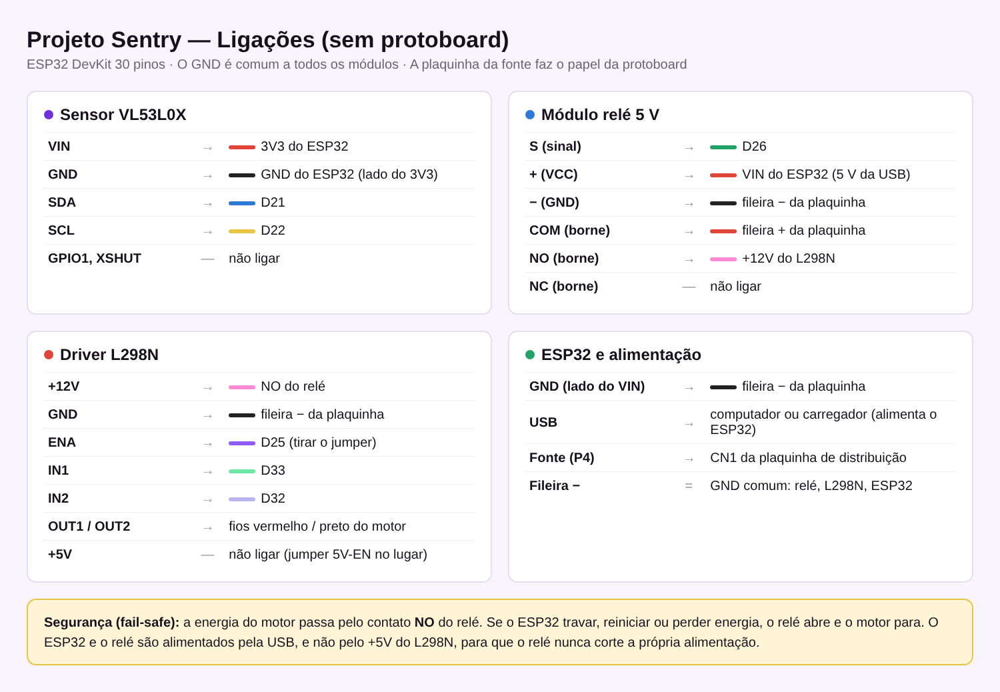

# Hardware do Projeto Sentry

## Lista de materiais

| Qtd | Componente | Função no projeto |
|---|---|---|
| 1 | ESP32 DevKit (30 pinos, ESP-WROOM-32) | Microcontrolador e servidor HTTP |
| 1 | Sensor laser VL53L0X (módulo GY-VL53L0XV2) | Mede a distância até a esteira; detecta peças e travamentos |
| 1 | Módulo relé 5 V, 1 canal (JQC-3FF-S-Z) | Corte físico da energia do motor (segurança) |
| 1 | Driver de motor L298N | Controla velocidade (PWM) e sentido do motor |
| 1 | Motor DC com caixa de redução (motor "TT" amarelo, 3–6 V) | Movimenta a esteira |
| 1 | Fonte chaveada bivolt (Unitel) com plugue P4 | Alimentação do motor |
| 1 | Placa de distribuição com conector P4 (CN1) | Distribui o + e o − da fonte (substitui a protoboard) |
| 1 | Esteira em MDF EA100 (kit) | Estrutura mecânica: rolos, lona e engrenagens |
| — | Jumpers macho-fêmea e fêmea-fêmea | Ligações |
| 1 | Cabo USB | Gravação e alimentação do ESP32 |

## Pinagem

| Módulo | Pino do módulo | Liga em |
|---|---|---|
| VL53L0X | VIN | 3V3 do ESP32 |
| VL53L0X | GND | GND do ESP32 (lado do 3V3) |
| VL53L0X | SDA | D21 |
| VL53L0X | SCL | D22 |
| VL53L0X | GPIO1, XSHUT | não ligar |
| Relé | S | D26 |
| Relé | + (VCC) | VIN do ESP32 |
| Relé | − (GND) | fileira − da plaquinha |
| Relé | COM | fileira + da plaquinha |
| Relé | NO | +12V do L298N |
| L298N | +12V | NO do relé |
| L298N | GND | fileira − da plaquinha |
| L298N | ENA | D25 (retirar o jumper do ENA) |
| L298N | IN1 / IN2 | D33 / D32 |
| L298N | OUT1 / OUT2 | motor DC |
| ESP32 | GND (lado do VIN) | fileira − da plaquinha |
| Fonte | P4 | CN1 da plaquinha |

## Decisões de projeto

**GND comum.** O ESP32, o relé e o L298N compartilham o mesmo GND (fileira − da plaquinha). Sem isso, os sinais do ESP32 não têm referência e o motor não obedece.

**Relé no contato NO (fail-safe).** A energia da fonte só chega ao L298N quando o ESP32 fecha o relé. Se o ESP32 travar, reiniciar ou ficar sem energia, o relé abre e o motor para. Por isso o relé e o ESP32 são alimentados pela USB, e não pelo +5V do L298N: se fossem, o relé cortaria a própria alimentação.

**Relé + L298N.** O L298N controla velocidade e sentido, mas só desliga o motor quando recebe a ordem. O relé corta a energia fisicamente, como tirar da tomada. Na parada de segurança o código faz os dois.

**Velocidade limitada por PWM.** O motor TT aguenta cerca de 6 V e o L298N perde cerca de 2 V. Com fonte de 12 V, o PWM padrão (120 de 255) entrega em média uns 4,7 V ao motor. O valor pode ser ajustado pela rota `/velocidade`.

**Sensor alimentado em 3,3 V.** Assim o barramento I2C trabalha no mesmo nível lógico do ESP32.

**Diodo 1N4007 dispensado.** O L298N e o módulo relé já têm diodos de proteção contra o pico de tensão do motor e da bobina.

## Montagem do sensor

O VL53L0X fica preso **acima da esteira, apontando para baixo**, a 4–8 cm da lona (abaixo de ~3 cm ele mede mal). Retire a película de proteção do sensor e evite luz forte direta. Na inicialização, o ESP32 mede a lona vazia (linha de base); uma peça é contada quando a distância fica 15 mm menor que essa referência.

## Problemas encontrados

- **Engrenagem patinando no eixo do motor.** O furo da engrenagem em MDF ficou folgado no eixo do motor TT; foi necessário fixá-la (parafuso na ponta do eixo ou cola) e ajustar a posição do motor nos furos oblongos para os dentes encaixarem por inteiro.
- **Rede de visitantes.** Redes com tela de login ou isolamento entre aparelhos impedem o acesso ao ESP32. Nos testes usamos o hotspot de um celular (2,4 GHz).
